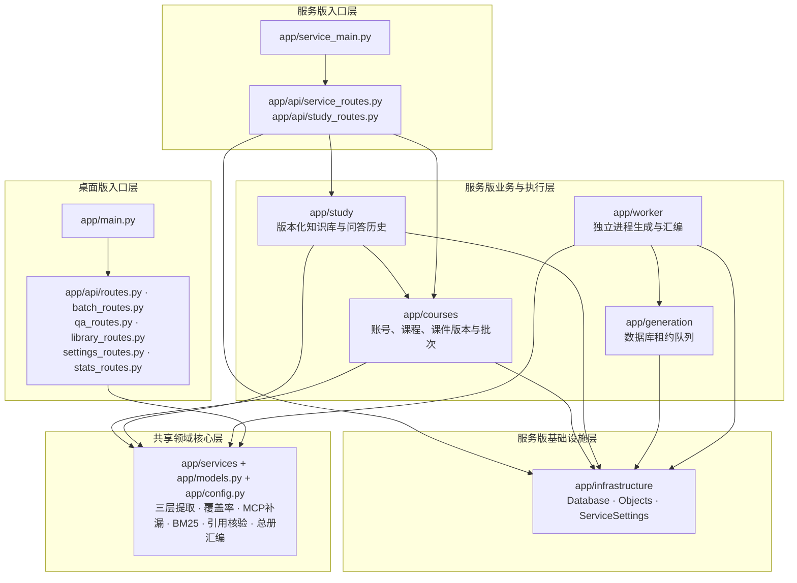

# 模块边界与单向依赖规范

仓库同时承载**多用户服务版**与**单机桌面版**，通过清晰的包分层复用底层提取、覆盖率、补漏与检索核心，防止两套运行态互相耦合。本文件中的禁止依赖规则由 `tests/test_architecture.py` 在每次测试与 CI 中通过 AST 静态解析强制执行。

## 1. 整体分层图

## 2. 各包职责与边界规则

| 包 / 目录 | 职责说明 | 允许依赖的内部模块 | 严禁依赖的内部模块（CI 强制） |
|---|---|---|---|
| `app/services/` | 纯业务算法与单机文件辅助（PPT/PDF 提取、图片过滤、术语覆盖率、MCP 补漏、BM25 检索、引用核验、总册汇编） | `app.models`, `app.config`, `app.services.*` | `app.courses`, `app.study`, `app.worker`, `app.generation`, `app.infrastructure`, `app.api.*`, `app.main`, `app.service_main` |
| `app/infrastructure/` | 服务版 MySQL/SQLite 连接池、S3/本地私有对象存储封装、服务环境变量解析 | `app.config`, `app.infrastructure.*`, `migrations.*` | `app.api.*`, `app.courses`, `app.study`, `app.worker`, `app.generation`, `app.main`, `app.service_main` |
| `app/generation/` | 批任务作业的短事务领取、续租、过期接管与领取标记校验 | `app.infrastructure.*`, `migrations.*` | `app.api.*`, `app.courses`, `app.study`, `app.worker` |
| `app/courses/` | 服务版认证会话、owner 校验、不可变课件/试题版本发布、批次幂等提交 | `app.infrastructure.*`, `app.services.reducer`, `migrations.*` | `app.api.*`, `app.study`, `app.worker`, `app.main` |
| `app/study/` | 服务版固定版本知识库构建、SSE 问答编排与个人问答历史 | `app.config`, `app.courses.*`, `app.infrastructure.*`, `app.services.*`, `migrations.*` | `app.api.*`, `app.worker`, `app.main` |
| `app/worker/` | API 进程外的后台任务循环：事务外拉取原件、解析生成、上传章节并凭标记提交 | `app.generation.*`, `app.infrastructure.*`, `app.models`, `app.services.*`, `app.worker.*` | `app.api.*`, `app.courses`, `app.study`, `app.main`, `app.service_main` |
| 服务版路由（`service_main.py`, `api/service_routes.py`, `api/study_routes.py`） | `/api/v1` HTTP 协议适配、请求大小拦截、错误状态码映射、`/health/*` 与服务静态页 | `app.api.types`, `app.courses.*`, `app.study.*`, `app.infrastructure.*`, `app.services.qa` | 桌面版入口 `app.main` 及桌面路由（`routes`, `batch_routes`, `qa_routes`, `library_routes`, `settings_routes`, `stats_routes`） |
| 桌面版路由（`main.py`, `api/routes.py` 等） | 桌面单用户本地上传、设置面板、批处理与本地知识库路由 | `app.config`, `app.models`, `app.services.*`, 桌面同层路由 | 服务版所有包（`courses`, `study`, `worker`, `generation`, `infrastructure`, `service_routes`, `study_routes`, `service_main`） |

## 3. 修改核心共享层的额外纪律

当需求需要改动 `app/services/` 下的共享模块时：
1. 函数签名与返回结构不得假设存在数据库会话、用户 ID 或 S3 对象键（数据输入输出通过 `Path`、内存字节或纯数据对象传递）。
2. 必须同时运行服务版测试（`tests/service/`）和桌面版回归测试（`tests/test_*.py`、`node tests/test_coverage_ui.js`），确认两侧均无退化。
