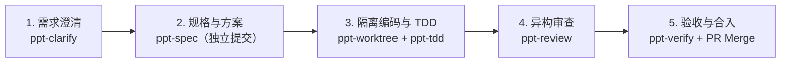

# AI 辅助开发流程（SDD + TDD）

本项目把 AI 当作**受规则、规格与自动化门禁约束的开发者**，而不是从头写到尾的代码生成器。核心方法论是 **SDD（Spec-Driven Development，规格驱动开发）** 配合 **TDD（Test-Driven Development，测试先行）**：先定义清楚做什么、边界在哪、用什么可观察行为验收，再让 AI 在隔离工作树中按小步红绿循环实现。

---

## 1. 变更分级（先定级，不走教条全流程）

拿到需求或缺陷后，第一步先按影响面判定级别；**命中更高一级的任意一项，即按更高一级执行**：

| 级别 | 判定标准 | 必需产物与流程 |
|---|---|---|
| **S 小改** | 可逆；不涉及权限、状态、数据库、公共 API；改动 ≤ 2 个文件（如界面文案、颜色样式、拼写修正） | 无需建 Spec；在 PR 描述写明改动与原因，跑通 [AGENTS.md](../../AGENTS.md) 完成检查即可 |
| **M 中改** | 调整公共 API 细节、校验提示或既有局部行为，但不改表结构、权限模型或跨进程状态 | 编写 [变更说明](../templates/change-note.md) → 按 `ppt-tdd` 先写失败测试再实现 → 按 `ppt-review` 清单自查 |
| **L 大改** | 涉及认证与归属隔离、课件/知识库版本语义、异步任务状态机、数据库迁移、新模块或新依赖 | 完整走下方五阶段闭环（`Clarify → Spec → TDD → Review → Verify`） |

---

## 2. L 级需求五阶段闭环

| 阶段 | 对应 Skill | 产出文件（基于模板） | 准出条件（Exit Criteria） |
|---|---|---|---|
| **1. 需求澄清** | [ppt-clarify](../../.agents/skills/ppt-clarify/SKILL.md) | `docs/specs/NNN-name/clarify.md`（[模板](../templates/clarify.md)） | AI 复述需求、列出歧义与非目标、给出 S/M/L 定级，**人工确认签字后才准进入下一阶段** |
| **2. 规格与方案** | [ppt-spec](../../.agents/skills/ppt-spec/SKILL.md) | `spec.md` / `design.md` / `tasks.md`（[spec](../templates/spec.md)、[design](../templates/design.md)、[tasks](../templates/tasks.md)）；重大取舍另立 [ADR](../templates/adr.md) | 验收标准带 `AC-1..N` 编号且外部可观察；已核对下载/重试等相邻流程；**单独提交 `docs(NNN): ...`，严禁混入业务实现代码** |
| **3. 编码与 TDD** | [ppt-worktree](../../.agents/skills/ppt-worktree/SKILL.md) + [ppt-tdd](../../.agents/skills/ppt-tdd/SKILL.md) | 测试用例、最小业务实现、回填 `tasks.md` | 独立 worktree 隔离端口与数据；关键 AC 先提交因预期原因失败的测试（`test(NNN): AC-x red`），再最小实现转绿并重构；默认只用合成数据与模型替身 |
| **4. 代码审查** | [ppt-review](../../.agents/skills/ppt-review/SKILL.md) | `docs/specs/NNN-name/review.md`（[模板](../templates/review.md)） | 不做“同源 AI 互夸”；逐条核对 AC、owner 派生、短事务边界、新依赖与**被删除代码**；重复出现 ≥ 2 次的问题固化进规则或测试 |
| **5. 验收与发布** | [ppt-verify](../../.agents/skills/ppt-verify/SKILL.md) | 更新 [服务版验收记录](../runbooks/service-verification.md) | 明确区分真实存储/跨进程验证与替身验证；涉及迁移或部署变更完成回滚演练；CI 全绿后按 [Git 规范](git-workflow.md) Merge commit 合入 |

---

## 3. 为什么不让“另一个 AI 直接审查上一个 AI”

同一家族模型在相同上下文下容易产生**同源盲区**（例如同时忽略并发发布冲突或跨账号 ID 猜测）。本项目的验证刻意采用**异构分层**：
1. **确定性工具链**：`ruff` 语法与未定义符号检查、`tests/test_architecture.py` 模块依赖方向断言、`scripts/check_docs.py` 文档状态与链接校验。
2. **契约与状态测试**：基于合成课件与模型替身的 `pytest` 回归套件 + 前端渲染断言 `node tests/test_coverage_ui.js`。
3. **真实依赖演练**：针对并发领取、租约过期、版本冲突和升级回滚，使用隔离的 MySQL 与 SeaweedFS 实例实跑验证。
4. **人工关键点把关**：重点看权限推导、事务范围、数据迁移、新引入依赖和被删除的旧逻辑。
